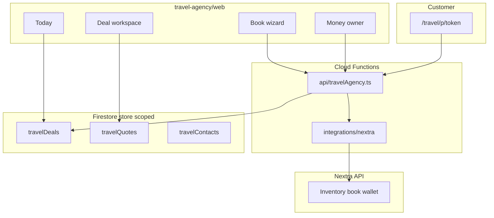

# Architecture — Travel Agency Platform

## High-level

## Packages

| Path | Role |
|------|------|
| [web/](web/) | React + Vite agent console (web-first) |
| [functions/src/api/travelAgency.ts](../../functions/src/api/travelAgency.ts) | HTTP: Nextra proxy, proposal tokens, deposits, owner summary |
| [functions/src/integrations/nextra/](../../functions/src/integrations/nextra/) | Normalized adapter + mock mode |

## Firestore (under `stores/{storeId}/`)

- `travelContacts`, `travelDeals`, `travelQuotes`, `travelActivities`, `travelTasks`, `travelDeposits`
- `travelSettings/nextra` — `apiBaseUrl` (keys in env/Secret Manager)
- `travelSettings/branding` — agency name for proposals
- `travelSettings/quoteSerial` — `QT-YYYY-MM-DD-###`

## API routes (`/api/travel/...`)

- `POST /travel/nextra/search|book|wallet|bookings`
- `POST /travel/proposal/link`, `GET /travel/proposal/public/:token`, `POST /travel/proposal/accept`
- `POST /travel/deposit/record`, `GET /travel/owner/summary`

## Security

- Agent routes: Firebase ID token + `assertStoreAccess` (Rule 35).
- Public proposals: HMAC-signed token, 30-day expiry.
- `NEXTRA_MOCK=true` for demo without live API.

## Deploy

1. Build web: `cd travel-agency/web && npm run build` → copy `dist` to hosting `dist/travel/`.
2. Deploy functions + firestore rules.
3. Set `TRAVEL_PROPOSAL_SECRET`, `NEXTRA_API_KEY`, `NEXTRA_MOCK` as needed.
